  

  

### `$ ls ./skills`

  

### `$ ls ./projects`

  
  

### `$ git log --graph`

  

### `$ ./stats --all`

  
  

  

### `$ ./contact --open`

  
  
  
  

  <code>&gt; EOF · thanks for scanning · wildanpanjii</code>

