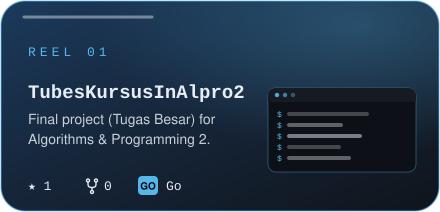
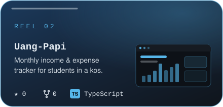
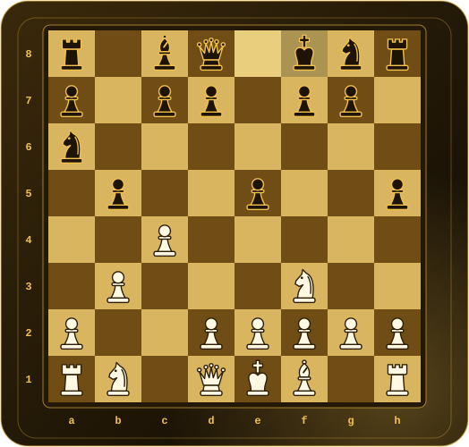

  

  

  
  
  
  
  
   
  
  
  
  
  

  
  

  

  

  
  

  

<b>Your move, White</b> · vs <b>Easy</b> bot · game 3 · move 6 · last: <code>Bxf8</code> by @wildanpanjii, bot replied <code>Kxf8</code>

Bot level: <b>Easy</b> (beginner, often picks weaker moves), locked until this game ends.

<b>How to play:</b> find your piece by its square (letters and numbers are on the board edges), then click the square it should move to. <code>×</code> = capture, <code>+</code> = check. Press <b>Create</b> on the page that opens.

<table align="center">
  <tr><th align="right">Piece</th><th align="left">Move to</th><th align="right">Piece</th><th align="left">Move to</th></tr>
  <tr><td align="right">♙ Pawn on <b>a2</b> →</td><td><a href="https://github.com/wildanpanjii/wildanpanjii/issues/new?title=chess%7Cmove%7Ca2a3%7C3.10&body=Just%20press%20%22Create%22%20below.%20The%20board%20redraws%20itself%20in%20about%20a%20minute."><kbd>a3</kbd></a> <a href="https://github.com/wildanpanjii/wildanpanjii/issues/new?title=chess%7Cmove%7Ca2a4%7C3.10&body=Just%20press%20%22Create%22%20below.%20The%20board%20redraws%20itself%20in%20about%20a%20minute."><kbd>a4</kbd></a></td><td align="right">♙ Pawn on <b>b3</b> →</td><td><a href="https://github.com/wildanpanjii/wildanpanjii/issues/new?title=chess%7Cmove%7Cb3b4%7C3.10&body=Just%20press%20%22Create%22%20below.%20The%20board%20redraws%20itself%20in%20about%20a%20minute."><kbd>b4</kbd></a></td></tr>
  <tr><td align="right">♙ Pawn on <b>c4</b> →</td><td><a href="https://github.com/wildanpanjii/wildanpanjii/issues/new?title=chess%7Cmove%7Cc4b5%7C3.10&body=Just%20press%20%22Create%22%20below.%20The%20board%20redraws%20itself%20in%20about%20a%20minute."><kbd>×b5</kbd></a> <a href="https://github.com/wildanpanjii/wildanpanjii/issues/new?title=chess%7Cmove%7Cc4c5%7C3.10&body=Just%20press%20%22Create%22%20below.%20The%20board%20redraws%20itself%20in%20about%20a%20minute."><kbd>c5</kbd></a></td><td align="right">♙ Pawn on <b>d2</b> →</td><td><a href="https://github.com/wildanpanjii/wildanpanjii/issues/new?title=chess%7Cmove%7Cd2d3%7C3.10&body=Just%20press%20%22Create%22%20below.%20The%20board%20redraws%20itself%20in%20about%20a%20minute."><kbd>d3</kbd></a> <a href="https://github.com/wildanpanjii/wildanpanjii/issues/new?title=chess%7Cmove%7Cd2d4%7C3.10&body=Just%20press%20%22Create%22%20below.%20The%20board%20redraws%20itself%20in%20about%20a%20minute."><kbd>d4</kbd></a></td></tr>
  <tr><td align="right">♙ Pawn on <b>e2</b> →</td><td><a href="https://github.com/wildanpanjii/wildanpanjii/issues/new?title=chess%7Cmove%7Ce2e3%7C3.10&body=Just%20press%20%22Create%22%20below.%20The%20board%20redraws%20itself%20in%20about%20a%20minute."><kbd>e3</kbd></a> <a href="https://github.com/wildanpanjii/wildanpanjii/issues/new?title=chess%7Cmove%7Ce2e4%7C3.10&body=Just%20press%20%22Create%22%20below.%20The%20board%20redraws%20itself%20in%20about%20a%20minute."><kbd>e4</kbd></a></td><td align="right">♙ Pawn on <b>g2</b> →</td><td><a href="https://github.com/wildanpanjii/wildanpanjii/issues/new?title=chess%7Cmove%7Cg2g3%7C3.10&body=Just%20press%20%22Create%22%20below.%20The%20board%20redraws%20itself%20in%20about%20a%20minute."><kbd>g3</kbd></a> <a href="https://github.com/wildanpanjii/wildanpanjii/issues/new?title=chess%7Cmove%7Cg2g4%7C3.10&body=Just%20press%20%22Create%22%20below.%20The%20board%20redraws%20itself%20in%20about%20a%20minute."><kbd>g4</kbd></a></td></tr>
  <tr><td align="right">♙ Pawn on <b>h2</b> →</td><td><a href="https://github.com/wildanpanjii/wildanpanjii/issues/new?title=chess%7Cmove%7Ch2h3%7C3.10&body=Just%20press%20%22Create%22%20below.%20The%20board%20redraws%20itself%20in%20about%20a%20minute."><kbd>h3</kbd></a> <a href="https://github.com/wildanpanjii/wildanpanjii/issues/new?title=chess%7Cmove%7Ch2h4%7C3.10&body=Just%20press%20%22Create%22%20below.%20The%20board%20redraws%20itself%20in%20about%20a%20minute."><kbd>h4</kbd></a></td><td align="right">♘ Knight on <b>b1</b> →</td><td><a href="https://github.com/wildanpanjii/wildanpanjii/issues/new?title=chess%7Cmove%7Cb1a3%7C3.10&body=Just%20press%20%22Create%22%20below.%20The%20board%20redraws%20itself%20in%20about%20a%20minute."><kbd>a3</kbd></a> <a href="https://github.com/wildanpanjii/wildanpanjii/issues/new?title=chess%7Cmove%7Cb1c3%7C3.10&body=Just%20press%20%22Create%22%20below.%20The%20board%20redraws%20itself%20in%20about%20a%20minute."><kbd>c3</kbd></a></td></tr>
  <tr><td align="right">♘ Knight on <b>f3</b> →</td><td><a href="https://github.com/wildanpanjii/wildanpanjii/issues/new?title=chess%7Cmove%7Cf3d4%7C3.10&body=Just%20press%20%22Create%22%20below.%20The%20board%20redraws%20itself%20in%20about%20a%20minute."><kbd>d4</kbd></a> <a href="https://github.com/wildanpanjii/wildanpanjii/issues/new?title=chess%7Cmove%7Cf3e5%7C3.10&body=Just%20press%20%22Create%22%20below.%20The%20board%20redraws%20itself%20in%20about%20a%20minute."><kbd>×e5</kbd></a> <a href="https://github.com/wildanpanjii/wildanpanjii/issues/new?title=chess%7Cmove%7Cf3g1%7C3.10&body=Just%20press%20%22Create%22%20below.%20The%20board%20redraws%20itself%20in%20about%20a%20minute."><kbd>g1</kbd></a> <a href="https://github.com/wildanpanjii/wildanpanjii/issues/new?title=chess%7Cmove%7Cf3g5%7C3.10&body=Just%20press%20%22Create%22%20below.%20The%20board%20redraws%20itself%20in%20about%20a%20minute."><kbd>g5</kbd></a> <a href="https://github.com/wildanpanjii/wildanpanjii/issues/new?title=chess%7Cmove%7Cf3h4%7C3.10&body=Just%20press%20%22Create%22%20below.%20The%20board%20redraws%20itself%20in%20about%20a%20minute."><kbd>h4</kbd></a></td><td align="right">♖ Rook on <b>h1</b> →</td><td><a href="https://github.com/wildanpanjii/wildanpanjii/issues/new?title=chess%7Cmove%7Ch1g1%7C3.10&body=Just%20press%20%22Create%22%20below.%20The%20board%20redraws%20itself%20in%20about%20a%20minute."><kbd>g1</kbd></a></td></tr>
  <tr><td align="right">♕ Queen on <b>d1</b> →</td><td><a href="https://github.com/wildanpanjii/wildanpanjii/issues/new?title=chess%7Cmove%7Cd1c1%7C3.10&body=Just%20press%20%22Create%22%20below.%20The%20board%20redraws%20itself%20in%20about%20a%20minute."><kbd>c1</kbd></a> <a href="https://github.com/wildanpanjii/wildanpanjii/issues/new?title=chess%7Cmove%7Cd1c2%7C3.10&body=Just%20press%20%22Create%22%20below.%20The%20board%20redraws%20itself%20in%20about%20a%20minute."><kbd>c2</kbd></a></td><td></td><td></td></tr>
</table>

You play White, the bot answers as Black. The board redraws itself in about a minute. Scoreboard: Visitors 0 · Bot 0 · Draws 0 <a href="https://github.com/wildanpanjii/wildanpanjii/issues/new?title=chess%7Cnewgame&body=Starts%20a%20fresh%20board.%20Only%20works%20when%20opened%20by%20the%20profile%20owner.">↺ New game</a> (profile owner only)

  
  
  
  

THE END · thanks for watching

