  

  

  
  
  
  
  
   
  
  
  
  
  

  
  

  

  

  
  

  

Hard bot vs Hard bot. A fresh game is played every day from a random opening, sit back and watch.

  
  
  
  

THE END · thanks for watching

